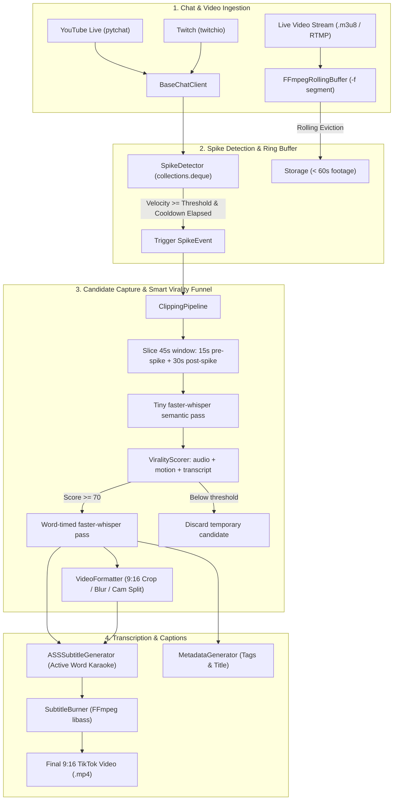

# Live Stream AI Engagement Clipper & TikTok Re-framer

An automated, modular Python application that monitors live stream chat for viral engagement spikes, continuously maintains a rolling video ring-buffer via FFmpeg, extracts the spike window, reframes gameplay to vertical **9:16**, transcribes audio with word-level timestamps using `faster-whisper`, and burns animated, TikTok/Reels-style dynamic captions into the video.

---

## 🏗️ Architecture Overview



---

## 📦 Project Structure

```
d:/clipping tool live stream/
├── config.py                  # Dataclass settings (Thresholds, Window sizes, Framing, Subtitle styles)
├── chat/
│   ├── base.py                # Abstract BaseChatClient & ChatMessage dataclass
│   ├── spike_detector.py      # Moving-window velocity calculator (collections.deque) & cooldowns
│   ├── youtube_client.py      # pytchat YouTube Live chat listener
│   ├── twitch_client.py       # twitchio Twitch chat listener
│   └── mock_client.py         # Synthetic chat simulator for offline testing
├── buffer/
│   └── ring_buffer.py         # FFmpeg segment ring-buffer with automated rolling disk eviction
├── video/
│   ├── formatting.py          # 9:16 vertical re-framing (Center crop, blurred padding, facecam split)
│   └── burn_in.py             # FFmpeg ASS subtitle burn-in
├── virality/
│   └── scorer.py              # Audio intensity, OpenCV motion, and transcript keyword scoring
├── transcription/
│   ├── transcriber.py         # faster-whisper speech-to-text with word-level timestamps
│   └── ass_generator.py       # TikTok-style ASS subtitle generator with word highlighting
├── ffmpeg_utils.py             # FFmpeg PATH / FFMPEG_PATH resolution
├── metadata_generator.py      # Automated viral title and hashtag extraction
├── dashboard/
│   └── app.py                 # Streamlit real-time monitoring & preview dashboard
├── pipeline.py                # Master Orchestrator coordinating all modules
├── main.py                    # CLI application entrypoint
├── requirements.txt           # Python package dependencies
└── tests/
    ├── test_spike_detector.py  # Unit tests for velocity and cooldown behavior
    ├── test_ass_generator.py   # Unit tests for ASS subtitle formatting
    ├── test_ring_buffer.py     # Unit tests for FFmpeg input mapping
    ├── test_ffmpeg_utils.py    # Unit tests for binary path errors
    ├── test_virality_scorer.py # Unit tests for multimodal scoring and thresholds
    └── test_youtube_client.py  # Unit test for threaded pytchat startup
```

---

## ⚡ Core Class Designs

### 1. Chat Spike Monitor (`chat/spike_detector.py`)
- **Sliding-Window Queue**: Implemented using `collections.deque`. Stores `(timestamp, weight, message, matched_keywords)`.
- **$O(1)$ Amortized Eviction**: Prunes messages older than `window_duration_seconds` (default: 3.0s).
- **Hype Keyword Weighting**: Messages containing words like `clutch`, `omg`, `wtf`, `clip`, `pog` receive an elevated weight multiplier (default: $2.5\times$), ensuring authentic audience excitement triggers clips rather than bot spam.
- **Cooldown Enforcement**: Ensures subsequent spikes within `cooldown_seconds` (default: 45s) are suppressed to avoid duplicate or overlapping clips.

### 2. FFmpeg Rolling Ring-Buffer (`buffer/ring_buffer.py`)
- **Continuous Stream Segmentation**: Uses FFmpeg's `-f segment -segment_time 2 -c copy` command to stream into rolling `.ts` chunks with zero CPU transcoding overhead.
- **Automated Eviction**: Background thread indexes completed segments and unlinks any segment older than `total_buffer_duration` (default: 60s), strictly bounding disk usage.
- **Spike Window**: The default clip is 45 seconds: 15 seconds before the chat spike and 30 seconds after it.

### 3. Smart Virality Funnel (`virality/scorer.py`)
- **Audio Intensity (40%)**: FFmpeg decodes low-rate mono PCM; NumPy compares peak loudness with the clip's baseline.
- **Visual Motion (30%)**: OpenCV samples resized grayscale frames, limiting CPU use while filtering static screens.
- **Transcript Semantics (30%)**: a tiny text-only faster-whisper pass searches engagement phrases; accepted clips then get the configured word-timed transcription.
- **Acceptance Gate**: Only candidates scoring at least 50/100 proceed to vertical formatting and export. Rejected temporary candidates are removed.
- **Resource limits**: OpenCV uses one thread, FFmpeg video encoders default to two threads, the scoring model is unloaded before the final model loads, and CPU transcription defaults to four threads and one worker.

### 4. Dynamic TikTok ASS Captions (`transcription/ass_generator.py`)
- **Micro-Chunking**: Groups words into 2–4 word phrases for rapid visual pacing.
- **Active Word Highlighting**: Generates discrete dialogue events where the currently spoken word is styled in bright gold/yellow (`&H0000E5FF&`), while inactive context words remain crisp white (`&H00FFFFFF&`) with a heavy black outline (`BorderStyle=1, Outline=5`).

---

## 🚀 Quick Start Guide

### 1. Install Dependencies & FFmpeg
Ensure [FFmpeg](https://ffmpeg.org/download.html) is installed and available on your system `PATH`. If needed, set `FFMPEG_PATH` and `FFPROBE_PATH` to the full paths of `ffmpeg.exe` and `ffprobe.exe`.
Install the Python packages:
```bash
pip install -r requirements.txt
```

### 2. Run the Test Suite
```bash
python -m unittest discover tests
```

### 3. Run in Offline Simulation Mode (Mock)
Test the entire pipeline locally without requiring a live stream:
```bash
python main.py --mock --framing blur_background --threshold 8.0
```
The default smart-funnel threshold is 50/100 and can be changed with `--min-virality-score` (the older `--virality-threshold` flag remains supported). Audio peaks are measured against `--audio-peak-threshold-db` (default: -18 dBFS). The initial transcript model defaults to `tiny`; choose another with `--scoring-whisper-model`. The default clip window is 45 seconds; use `--clip-duration` and `--pre-trigger-seconds` to adjust it. Choose `--framing split_screen` to detect a face for the top 30% panel and place gameplay in the lower 70%; if no face is found, the configured facecam region is used.
At startup the app waits until the pre-trigger buffer is ready before connecting to chat, so the first detected spike can include its full lead-in.

### 4. Run with YouTube Live or Twitch
```bash
# YouTube Live (provide separate video/audio URLs when the platform exposes them):
python main.py --youtube "VIDEO_ID" --stream-url "VIDEO_HLS_URL" --audio-stream-url "AUDIO_HLS_URL"

# Twitch Channel:
python main.py --twitch "shroud" --stream-url "http://twitch_hls_url"
```
If FFmpeg reports that an output WAV has no stream, the captured clip has no audio track. Provide the separate audio HLS URL with `--audio-stream-url` when needed; otherwise speech captions are skipped and the audio virality score is zero.

### 5. Launch the Streamlit Live Dashboard
```bash
streamlit run dashboard/app.py
```
From the web dashboard, you can:
- Adjust velocity thresholds and cooldown sliders in real time.
- View live charts of chat velocity.
- Trigger manual test bursts.
- Preview and download generated 9:16 vertical clips with hardcoded subtitles.
# live-strean-clipping-tool

